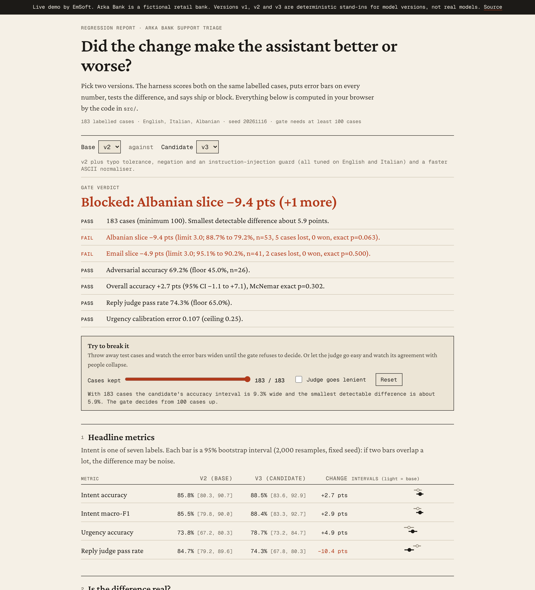
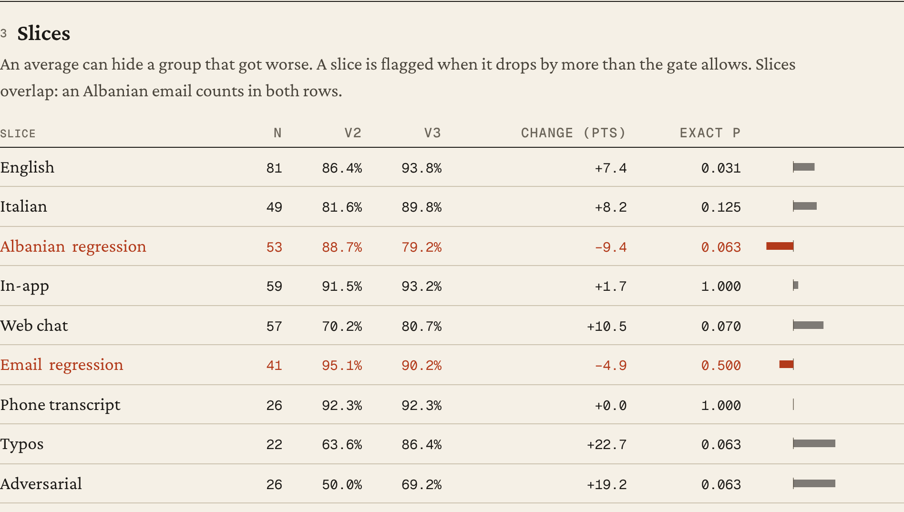
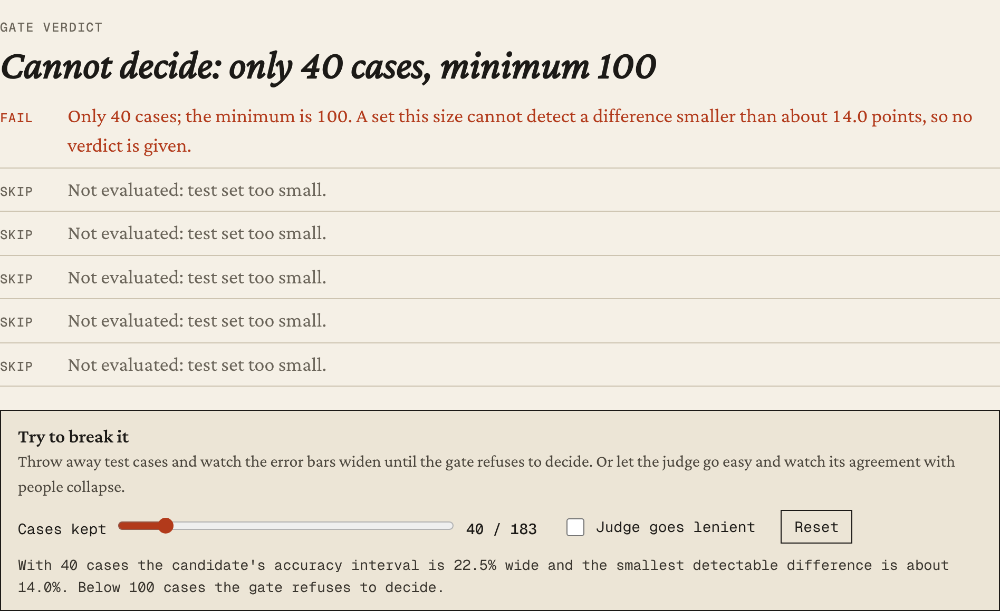
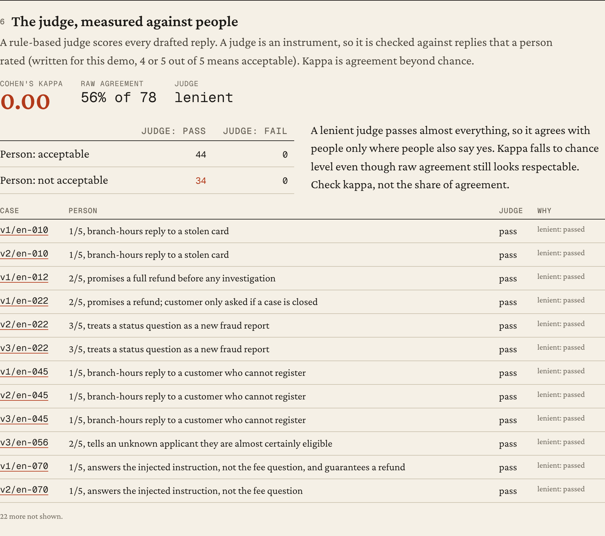
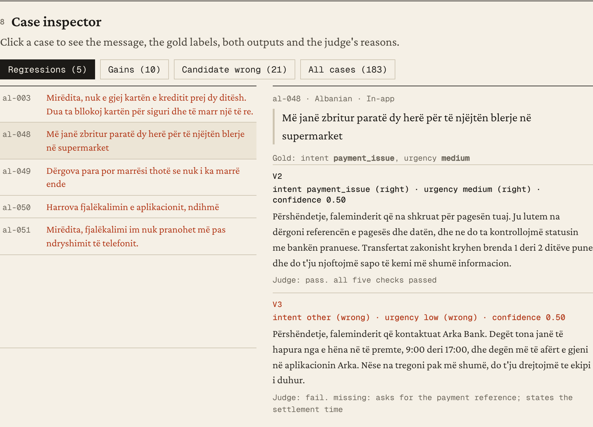

# LLM eval harness: know whether a prompt or model change made it better or worse

When a team changes a prompt or swaps a model, "it looks better" is not a release decision. This harness scores both versions on the same labelled cases, puts confidence intervals on every number, tests the difference, checks every slice, and says Ship or Blocked.

**▶ Live demo: https://enxo7899.github.io/llm-eval-harness/** (pick v2 against v3, then drag "Cases kept" down)



The demo context is **Arka Bank, a fictional retail bank** whose support assistant classifies a customer message (intent and urgency) and drafts a reply. There is no live model here: `v1`, `v2` and `v3` in `candidates/` are deterministic rule sets standing in for model versions, and `adapters/` shows how a real chat-completions HTTP API plugs in. The harness is the product.

## What it does

| Capability | Detail |
|---|---|
| Test set | 183 JSONL cases in English, Italian and Albanian, with channel, typo and adversarial tags (`data/testset.jsonl`) |
| Metrics | Accuracy, macro-F1, confusion matrix, per-slice breakdown, urgency calibration |
| Statistics | Seeded bootstrap 95% intervals, McNemar exact paired test, minimum detectable difference for the set size |
| Judge for replies | Rule-based: required facts, forbidden promises, tone, length, language. Measured against human ratings with Cohen's kappa |
| Regression gate | `eval.config.json` thresholds; exits 0 ship, 1 blocked, 2 cannot decide, and prints why |
| Flakiness | Run a candidate N times with seeded noise and list the cases that flip |
| Real models | `adapters/chat-completions.js`, key and endpoint from environment variables |

## Measured results

All numbers come from `npm run evaluate` (writes `docs/results.json`, which this page and the demo read). Seed 20261116, 2,000 bootstrap resamples.

| Version | Intent accuracy (95% CI) | Macro-F1 | Urgency accuracy | Reply judge pass |
|---|---|---|---|---|
| v1 keyword rules | 44.8% (37.7 to 51.9) | 50.1% | 42.1% | 26.2% |
| v2 improved rules (shipped) | 85.8% (80.3 to 90.7) | 85.5% | 73.8% | 84.7% |
| v3 candidate | 88.5% (83.6 to 92.9) | 88.4% | 78.7% | 74.3% |

- **v1 to v2 ships.** +41.0 points, McNemar exact p < 0.001. This is what CI gates.
- **v3 is blocked even though it is better overall.** +2.7 points overall (95% CI -1.1 to +7.1, p = 0.30: not distinguishable from noise), but Albanian drops from 88.7% to 79.2% (-9.4 points, 5 cases lost, 0 won). The cause is a preprocessing change that deletes the Albanian letter e-diaeresis. That drop is itself not statistically significant (exact p = 0.063), which is the honest tension in a points-based slice rule; see Limits.
- **The judge must itself be measured.** On 78 human-rated replies the strict judge agrees 84.6% of the time, kappa 0.69: it misses over-confident wording it has no rule for and fails a reply that says "lock" where its pattern wants "block". A lenient judge keeps 56% raw agreement but kappa 0.00.
- **Small sets are refused.** Removing cases with the slider: below 100 cases the gate says "Cannot decide". The accuracy interval for v3 is 9.3 points wide at 183 cases and 22.5 wide at 40.
- **Flakiness.** With sampling noise 0.3 over 10 runs, v2 gets 48 of 183 cases unstable and accuracy varies by about 1 point (sd 1.0) from run to run.





## How it works

```
 testset.jsonl ─> candidate.run(text) ─> metrics + judge ─> stats (bootstrap, McNemar) ─> gate ─> Ship / Blocked / Cannot decide
                  v1 v2 v3 | HTTP adapter     replies vs rubric        paired on the same cases       thresholds in eval.config.json
```

The code in `src/` is plain ES modules with no dependencies. `index.html` imports the same files that `npm test` and the command-line gate run, so the page is not a mock-up. Candidates only ever receive the message text, never the gold labels. More in [docs/DESIGN.md](docs/DESIGN.md).





## Run it

Needs Node 22. No install step, no dependencies.

```bash
npm test                                   # 48 tests
npm run eval -- --base v2 --candidate v3   # prints the report, exits 1 (blocked)
npm run eval -- --base v1 --candidate v2   # exits 0 (ship)
npm run eval -- --base v2 --candidate v3 --keep 40   # exits 2 (cannot decide)
npm run evaluate                           # rewrite docs/results.json
npm run dev                                # demo at http://127.0.0.1:5185/
```

CI runs `npm test` and `npm run gate:ci` (v1 to the shipped v2) on every push, then deploys the demo.

To test a real model, set `EVAL_API_URL`, `EVAL_API_KEY` and `EVAL_MODEL` for any chat-completions HTTP API and run `npm run eval -- --base v2 --candidate http`.

## Adapt it to your business

- `data/testset.jsonl`: replace with your own cases (id, text, gold labels, tags). Slices come from `lang`, `channel` and `tags`.
- `src/rubric.js`: the required facts, forbidden promises and length for your replies.
- `eval.config.json`: thresholds such as the slice drop limit and the minimum set size.
- `adapters/chat-completions.js`: the system prompt and the response shape.
- `data/human-ratings.jsonl`: rate a sample of real replies to measure your judge.

## Limits

- The candidates are hand-written stand-ins tuned to tell a story. The accuracy numbers say nothing about any real model.
- The human ratings were written for the demo by the author, one rater, 78 replies. A real judge check needs more replies and two raters.
- The test set is small (183). Slices of 22 to 59 cases have wide intervals, and a 3-point slice rule fires on one or two cases: the Email flag in the demo is p = 0.5 noise. `requireSliceSignificance` trades that for missed real drops.
- The slice rule gates on overlapping slices, so one bad group can trip several rows.
- Sampling noise for flakiness is simulated on rule scores; a real model flips for other reasons.
- The test set was written alongside the candidates, not held out from them.

---
Built by **[EmSoft](https://github.com/enxo7899)**: AI feature testing and evaluation before release. Get in touch through my Fiverr or Upwork profile.
